<!-- Generated cards: scripts/render_cards.py, refreshed daily by .github/workflows/profile.yml.
     Each card has a -dark and -light SVG, swapped by <picture>. Keep this block free of blank
     lines and keep each row of cards on one line with no spaces between them. -->

<picture><source media="(prefers-color-scheme: dark)" srcset="./cards/hero-dark.svg" /></picture> 
<picture><source media="(prefers-color-scheme: dark)" srcset="./cards/heatmap-dark.svg" /></picture> 
<picture><source media="(prefers-color-scheme: dark)" srcset="./cards/year-dark.svg" /></picture> 
<a href="https://github.com/Andrei9383/Blucast"><picture><source media="(prefers-color-scheme: dark)" srcset="./cards/tile-0-dark.svg" /></picture></a><a href="https://github.com/Andrei9383?tab=repositories"><picture><source media="(prefers-color-scheme: dark)" srcset="./cards/tile-1-dark.svg" /></picture></a><a href="https://github.com/Andrei9383/vim-classic-themes-zed"><picture><source media="(prefers-color-scheme: dark)" srcset="./cards/tile-2-dark.svg" /></picture></a> 
<picture><source media="(prefers-color-scheme: dark)" srcset="./cards/title-building-dark.svg" /></picture> 
<a href="https://github.com/Andrei9383/Blucast"><picture><source media="(prefers-color-scheme: dark)" srcset="./cards/project-blucast-dark.svg" /></picture></a><a href="https://github.com/Andrei9383/uipath-hack"><picture><source media="(prefers-color-scheme: dark)" srcset="./cards/project-audiobolt-dark.svg" /></picture></a> 
<a href="https://github.com/Andrei9383/smarthack"><picture><source media="(prefers-color-scheme: dark)" srcset="./cards/project-wattsentry-dark.svg" /></picture></a><a href="https://github.com/Andrei9383/Windmon"><picture><source media="(prefers-color-scheme: dark)" srcset="./cards/project-windmon-dark.svg" /></picture></a> 
<picture><source media="(prefers-color-scheme: dark)" srcset="./cards/log-dark.svg" /></picture>

<a href="https://github.com/Andrei9383/Blucast">Blucast</a> &nbsp;/&nbsp; <a href="https://github.com/Andrei9383/dotfiles">dotfiles</a> &nbsp;/&nbsp; <a href="https://github.com/Andrei9383?tab=repositories">all repos</a>

